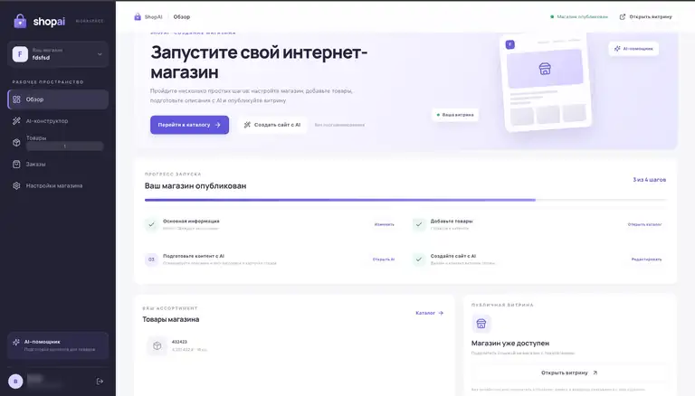
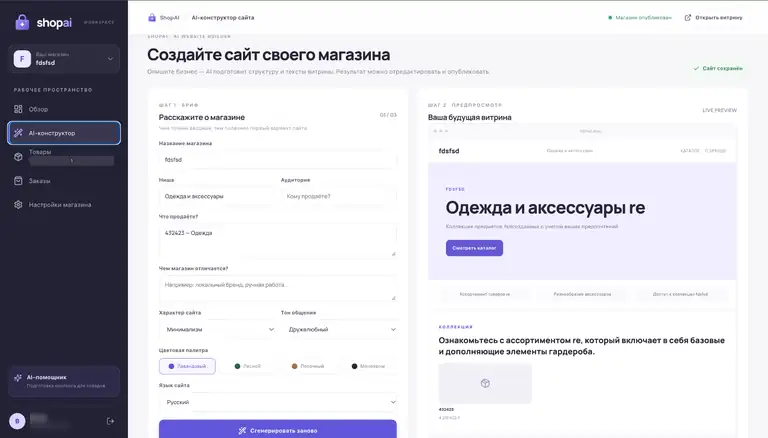
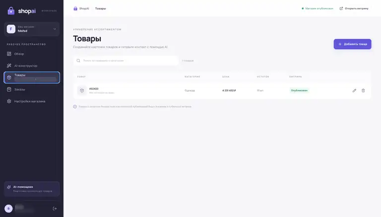

# ShopAI

**ShopAI — платформа для создания интернет-магазинов с AI-помощником.**

Сервис помогает владельцу небольшого бизнеса пройти основной путь запуска магазина в одном рабочем пространстве: создать магазин, наполнить каталог, подготовить тексты с помощью AI, собрать оформление витрины, опубликовать её и принимать заявки на заказы.

## Демо

**Работающая версия:** [shopai.karimover06.workers.dev](https://shopai.karimover06.workers.dev/)

Production-развёртывание работает на Cloudflare Workers: React/Vite frontend отдаётся через Workers Static Assets, Express API выполняется внутри Worker, постоянные данные хранятся в Cloudflare D1, а изображения — в таблице D1 `uploads` в формате BLOB. Локальная разработка использует JSON-файл и папку `uploads/`.

## Скриншоты

Скриншоты ниже показывают интерфейс на демонстрационном аккаунте. Значения в полях, карточках товаров и каталоге являются тестовыми.

### Панель управления


### AI-конструктор сайта


### Каталог товаров


## Возможности MVP

- Регистрация, вход и выход владельца магазина.
- Одно рабочее пространство и один магазин на аккаунт.
- Каталог: добавление, просмотр, поиск, редактирование и удаление товаров.
- Карточка товара: цена, остаток, описание, SEO-заголовок и фотография PNG/JPEG/WebP до 1,7 МБ.
- AI-помощник товара: создание черновика описания и SEO-заголовка по названию, категории и характеристикам.
- AI-конструктор сайта: бриф о магазине, генерация текстов витрины через Cloudflare Workers AI, предпросмотр, редактирование ключевых блоков, выбор палитры и стиля, сохранение конфигурации.
- Публичная витрина по адресу `/shop/:slug`, которая отображает сохранённую конфигурацию сайта и опубликованные товары.
- Корзина и оформление заявки на заказ.
- Кабинет владельца: список заказов и изменение статусов.
- Проверка доступного остатка при заказе; возврат остатка при отмене.

AI возвращает структурированный контент и параметры оформления. Сайт отображается контролируемым React-шаблоном; модель не генерирует и не исполняет произвольный HTML/JavaScript.

## Технологический стек

| Часть | Технологии |
|---|---|
| Frontend | React 19, TypeScript, Vite |
| Backend | Node.js 22+, Express; Cloudflare Workers adapter через `cloudflare:node` |
| Хранение | Локально: JSON-файл; production: Cloudflare D1; изображения: D1 BLOB (`uploads`) |
| Авторизация | HttpOnly session cookie, хеширование паролей через scrypt |
| AI | Cloudflare Workers AI, OpenAI-совместимый Chat Completions API |\n| Хостинг | Cloudflare Workers + Workers Static Assets |
| Тесты | Node.js built-in test runner |
| UI | CSS, Lucide Icons |

## Быстрый запуск на macOS / Linux

Нужен **Node.js 22 или новее**.

Открой Terminal и выполни:

```bash
git clone https://github.com/karimover/ShopAI.git
cd ShopAI
npm install
cp .env.example .env
```

Открой файл `.env` в редакторе. На Mac можно использовать TextEdit:

```bash
open -a TextEdit .env
```

Заполни переменные Cloudflare:

```env
CLOUDFLARE_ACCOUNT_ID=твой_account_id
SHOPAI_CLOUDFLARE_API_TOKEN=твой_workers_ai_token
CLOUDFLARE_AI_MODEL=@cf/google/gemma-4-26b-a4b-it
PORT=3001
```

Сохрани файл и запусти приложение:

```bash
npm run dev
```

Vite покажет адрес frontend, обычно **http://localhost:5173**. Backend API работает на **http://localhost:3001**. Открой адрес Vite в браузере.

## Быстрый запуск на Windows

Открой PowerShell в папке, где хочешь разместить проект:

```powershell
git clone --branch mvp/full-stack-core https://github.com/karimover/ShopAI.git
Set-Location ShopAI
npm install
Copy-Item .env.example .env
notepad .env
```

Заполни в открывшемся файле те же переменные Cloudflare, сохрани его и запусти:

```powershell
npm run dev
```

Открой **http://localhost:5173**.

## Настройка Cloudflare Workers AI

Реальная генерация сайта и карточек использует Cloudflare Workers AI.

1. Открой Cloudflare Dashboard.
2. Перейди в **AI → Workers AI → Use REST API**.
3. Создай Workers AI API Token.
4. Скопируй Account ID с этой страницы.
5. Добавь Account ID и токен в локальный файл `.env`.
6. Перезапусти backend после изменения переменных окружения.

Используемая модель по умолчанию:

```text
@cf/google/gemma-4-26b-a4b-it
```

**Важно:** файл `.env` содержит секретный токен. Он исключён из Git через `.gitignore`. Не отправляй токен в чат, не добавляй его в исходный код и не публикуй скриншоты файла.

Если Cloudflare не настроен:
- AI-помощник карточки товара переходит в явно обозначенный demo-режим;
- AI-конструктор сайта сообщает, что для генерации нужен Cloudflare Workers AI;
- демонстрационный текст не должен выдаваться за ответ реальной модели.

Лимиты и доступность модели определяются настройками и тарифом Cloudflare.

## Основной сценарий демонстрации

1. Зарегистрировать владельца и создать магазин.
2. Добавить товар: название, категорию, цену, остаток и фотографию.
3. Сгенерировать описание и SEO-заголовок карточки товара.
4. Открыть **AI-конструктор**, заполнить бриф и сгенерировать сайт.
5. Проверить предпросмотр, изменить заголовок/тексты/преимущества и сохранить конфигурацию.
6. Опубликовать магазин и открыть публичную витрину.
7. Добавить товар в корзину и отправить заявку.
8. Вернуться в кабинет владельца и обработать заказ.

В MVP заказ является **заявкой**. Онлайн-оплата, эквайринг и доставка не подключены.

## Проверки перед демонстрацией

```bash
node --check server/index.mjs
npm test
npm run build
```

Для CI используется та же базовая последовательность: проверка синтаксиса backend, API-тесты и сборка frontend.

После успешной сборки локальный production-запуск:

```bash
npm start
```

Команда запускает Express и раздаёт frontend из каталога `dist`. Перед этим необходимо выполнить `npm run build` и настроить `.env`.

## Данные и сброс локальной базы

- Основные данные: `data/shopai.json`.
- Загруженные фотографии: `uploads/`.
- Каталоги данных и загрузок исключены из Git.

Чтобы полностью сбросить локальные тестовые данные на macOS/Linux:

1. Останови сервер сочетанием `Ctrl + C`.
2. Выполни:

```bash
rm -f data/shopai.json
rm -rf uploads/*
```

На Windows PowerShell:

```powershell
Remove-Item data/shopai.json -ErrorAction SilentlyContinue
Get-ChildItem uploads -File | Remove-Item
```

Это удалит локальные аккаунты, магазины, товары, заказы и загруженные изображения. Не выполняй сброс, если данные нужны.

## Если что-то не запускается

**Порт 5173 или 3001 уже занят.** Останови предыдущий процесс ShopAI или освободи занятый порт, затем повтори запуск.

**После обновления страницы появился вход.** Проверь, что браузер не потерял сессию; войди в аккаунт повторно.

**AI вернул ошибку.** Проверь Account ID, актуальность Workers AI API Token, имя модели и сообщение в терминале backend. Не вставляй токен в переписку или issue.

**Изменения кода не появились в браузере.** Убедись, что находишься в ветке `main`, выполни `git pull origin main` и обнови страницу.

## Структура репозитория

```text
ShopAI/
├── server/index.mjs       # Express API, авторизация, каталог, AI, заказы
├── src/App.tsx            # Кабинет владельца, AI-конструктор, публичная витрина
├── src/index.css          # Стили приложения
├── public/                # Статические файлы, логотип и favicon
├── tests/api.test.mjs     # Интеграционные API-тесты
├── docs/
│   ├── MVP_SCOPE.md       # Требования и границы MVP
│   ├── ARCHITECTURE.md    # Архитектура и маршруты API
│   ├── AI_USAGE.md        # Настройка и ограничения AI
│   ├── TESTING.md         # План и результаты проверок
│   ├── TEAM_PLAN.md       # Командный план и бэклог
│   ├── ROADMAP.md         # Дальнейшее развитие
│   ├── PRODUCT_ANALYSIS.md
│   ├── COMPETITIVE_ANALYSIS.md
│   └── DESIGN_REFERENCES.md
├── TZ.md                 # Техническое задание текущей реализации
├── .env.example          # Шаблон локальных переменных
└── package.json
```

## Ограничения текущего MVP

- В локальном режиме используется JSON-хранилище. В Cloudflare deployment постоянные данные хранятся в D1; текущая схема хранит состояние приложения в одной версионируемой JSON-записи, поэтому перед коммерческой нагрузкой её следует нормализовать.
- Нет онлайн-оплаты, эквайринга, расчёта доставки и интеграции со службами доставки.
- Нет собственных доменов, командных ролей и полноценного drag-and-drop редактора блоков.
- Сайт собирается из управляемого React-шаблона; AI меняет контент и поддерживаемые настройки дизайна.
- Нет результатов нагрузочного тестирования на 500 пользователей и измеренной статистики качества AI на наборе из типовых запросов.

Не представляй целевые показатели проекта как достигнутые без соответствующих измерений.

## Документация

- [Границы MVP](docs/MVP_SCOPE.md)
- [Архитектура](docs/ARCHITECTURE.md)
- [Работа AI](docs/AI_USAGE.md)
- [План тестирования](docs/TESTING.md)
- [Командный план](docs/TEAM_PLAN.md)
- [Roadmap](docs/ROADMAP.md)
- [Техническое задание](TZ.md)


## Публикация на Cloudflare

ShopAI разворачивается как единое приложение на **Cloudflare Workers**:
- React/Vite frontend раздаётся через Workers Static Assets;
- Express API работает внутри Worker с флагом `nodejs_compat`;
- постоянные данные хранятся в Cloudflare D1;
- фотографии хранятся отдельными BLOB-записями в Cloudflare D1 (до 1,7 МБ на файл);
- AI-ключ хранится в Worker Secret, а не в Git или frontend.

### 1. Подготовка Cloudflare

Установи зависимости проекта, затем авторизуй Wrangler:

```bash
npm install
npx wrangler@latest login
```

Команда откроет браузер. Войди в тот Cloudflare-аккаунт, где создаёшь Workers AI.

### 2. Создание хранилищ

Создай D1:

```bash
npm run cf:db:create
```

Команда D1 покажет `database_id`. Открой `wrangler.jsonc` и замени `REPLACE_WITH_D1_DATABASE_ID` на реальный ID. Имя базы должно остаться `shopai-db`, binding — `DB`.

### 3. Создание таблицы D1

Применить миграцию к удалённой базе:

```bash
npm run cf:db:migrate
```

Миграции создают таблицу состояния ShopAI и отдельную таблицу для бинарных фотографий. Для изображений в Cloudflare-режиме действует лимит 1,7 МБ на файл.

### 4. Добавление секретов AI

Сначала отзови все Workers AI токены, которые ранее отправлялись в чат или попадали на скриншоты. Создай новый токен с разрешением **Account → Workers AI → Read**.

Добавь Account ID и новый токен через безопасный ввод Wrangler:

```bash
npx wrangler@latest secret put CLOUDFLARE_ACCOUNT_ID
npx wrangler@latest secret put CLOUDFLARE_API_TOKEN
```

После каждой команды Wrangler попросит ввести значение. Для опубликованного Worker имя секрета остаётся `CLOUDFLARE_API_TOKEN`. Не вставляй секрет в команду, GitHub, issue или чат. Имя модели уже задано в `wrangler.jsonc`.

### 5. Первый деплой

```bash
npm run deploy:cloudflare
```

Wrangler загрузит frontend и Worker и напечатает публичный адрес вида `https://shopai.<account-subdomain>.workers.dev`. Открой ссылку, зарегистрируй отдельный демонстрационный аккаунт, добавь товар и проверь генерацию AI.

### 6. Проверка после деплоя

Проверь:
1. Главная страница открывается по HTTPS.
2. Регистрация и повторный вход работают.
3. После перезагрузки сохраняются магазин и товары.
4. Фотография товара открывается по адресу `/uploads/...`.
5. AI-генерация товара и сайта отвечает.
6. Публичная витрина открывается по `/shop/:slug`.
7. Тестовая заявка появляется в кабинете владельца.

Health-check API: `/api/health`.

### Хранение данных в Cloudflare

В Cloudflare-режиме состояние ShopAI хранится в одной версионируемой записи D1, а фотографии — отдельными BLOB-записями в таблице `uploads`. Это позволяет развернуть учебный MVP без R2 и без подключения платёжного метода. Ограничение D1 на одну строку/BLOB — 2 МБ, поэтому загрузка изображений ограничена 1,7 МБ; бесплатный лимит базы — 500 МБ. Запись состояния защищена проверкой версии: при одновременном изменении из разных Worker isolates запрос может получить HTTP 409, вместо того чтобы молча затереть чужие данные. Перед коммерческой нагрузкой следует нормализовать User, Session, Store, Product и Order в отдельные таблицы D1 и выполнять критичные операции с заказами в SQL-транзакциях.

Локальный режим не меняется: он по-прежнему использует `data/shopai.json` и папку `uploads/`.
